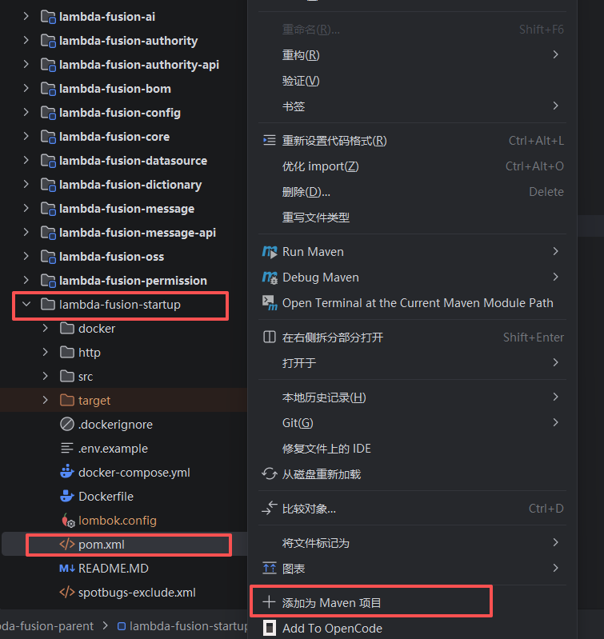
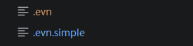
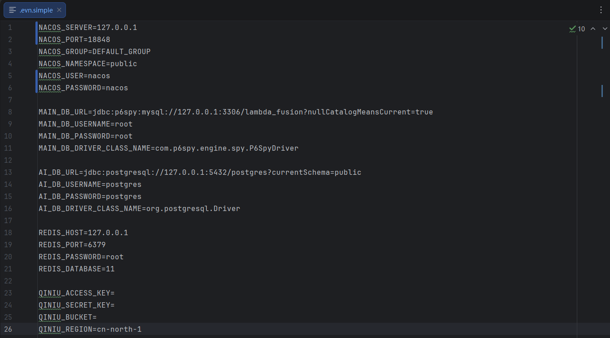
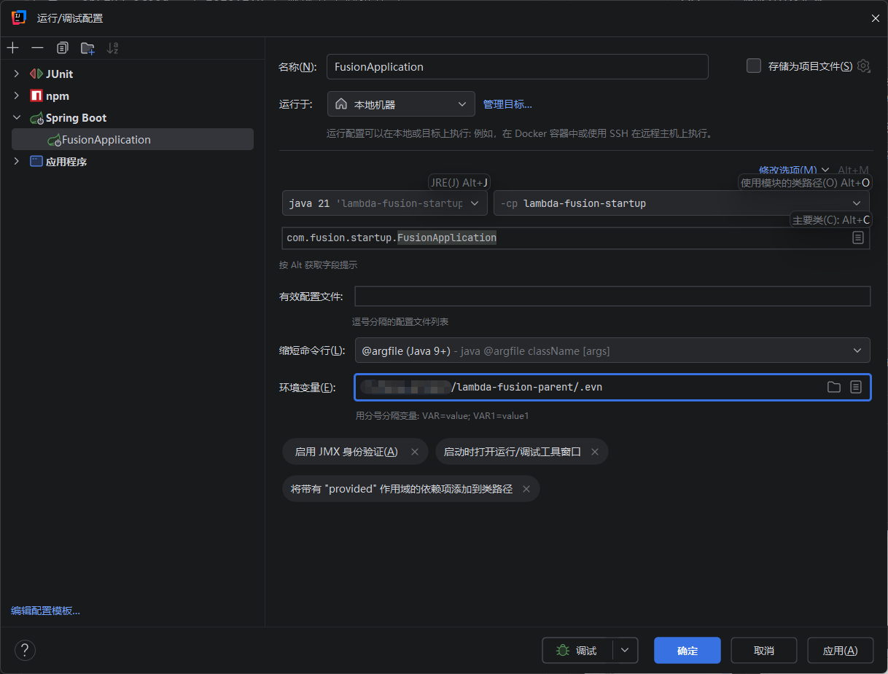

# 快速启动指南（lambda-fusion-startup）

`lambda-fusion-startup` 是 Lambda Fusion 框架的**可运行演示应用**，端口 `20005`。它把框架的全部能力（权限、多租户、配置、字典、数据源、附件、AI 智能平台）聚合到一个可直接启动的 Spring Boot 应用里，用于本地开发与功能验证。

启动它**只需要做一件事：配置好环境变量**，其余依赖注入、数据源装配、建表均由框架自动完成。

---

## 一、环境准备

| 依赖 | 版本 | 说明 |
|------|------|------|
| ☕ JDK | 21+ | 框架基于 JDK 21 构建 |
| 🔧 Maven | 3.8+ | 无 wrapper，使用系统 `mvn` |
| 🐬 MySQL | 8.0+ | 主库（业务数据 + Liquibase 建表 + 配置源）；与 OceanBase 二选一 |
| 🐘 PostgreSQL | 12+ | AI 库（pgvector 向量检索 / 知识库 RAG）；**可选**，无 pg 可降级或改用 OceanBase（见下文） |
| 🌊 OceanBase | 4.3.5+ | **可选**，MySQL 模式：一台 OB 同时承担主库与 AI 向量检索，使用后**无需再安装 MySQL 与 PostgreSQL**（见 [OceanBase 快速启动指南](quick-start-ob.md)） |
| 🍃 Redis | 6.0+ | 缓存与会话 |

> 基座 `lambda-cloud-parent`、`lambda-cloud-project-parent` 需先安装到本地仓库或私服，再构建本仓库。

> **首次构建 `lambda-cloud-parent` 的自举说明：** 如果本地仓库中从未成功安装过
> `lambda-cloud-core` 和 `lambda-cloud-processor`，直接执行全量构建可能会提示找不到
> `com.lambda.cloud:lambda-cloud-processor`。这是因为基座父 POM 已将该模块配置为注解处理器，
> 而处理器本身又依赖 `lambda-cloud-core`。此时可按以下顺序完成一次自举：
>
> 1. 在 `lambda-cloud-parent/pom.xml` 的 `maven-compiler-plugin` →
>    `annotationProcessorPaths` 中，临时注释 `lambda-cloud-processor` 对应的 `<path>`。
> 2. 在 `lambda-cloud-parent` 根目录执行
>    `mvn -pl lambda-cloud-processor -am clean install`，先将 `lambda-cloud-core` 和
>    `lambda-cloud-processor` 安装到本地仓库。
> 3. 恢复刚才注释的 `<path>`，再执行 `mvn clean install` 完成基座的全量构建。
>
> 该操作通常只在本地仓库没有上述 SNAPSHOT 的首次构建时需要；不要提交临时的 POM 改动。

---

## 二、启动步骤

### 步骤 1：将 startup 模块添加为 Maven 项目

`lambda-fusion-startup` 是一个独立的可运行模块。打开 IDE 后，先在模块列表中找到 `lambda-fusion-startup`，右键它的 `pom.xml`，选择 **「添加为 Maven 项目 / Add as Maven Project」**，让 IDE 正确识别并加载该模块及其依赖。



### 步骤 2：配置环境变量文件

框架的运行配置**完全由环境变量驱动**——`application.yml` 中所有数据库、Redis、OSS 等连接信息都通过 `${...}` 占位符从环境变量读取，代码里不硬编码任何连接串。

仓库根目录提供了一个示例环境变量文件 `.evn.simple`（与正式环境变量文件 `.evn` 放在同一目录），内容如下：



将其复制为 `.evn`（即你的本地环境变量文件），按需修改其中的值：

```
NACOS_SERVER=127.0.0.1
NACOS_PORT=18848
NACOS_GROUP=DEFAULT_GROUP
NACOS_NAMESPACE=public
NACOS_USER=nacos
NACOS_PASSWORD=nacos

MAIN_DB_URL=jdbc:p6spy:mysql://127.0.0.1:3306/lambda_fusion?nullCatalogMeansCurrent=true
MAIN_DB_USERNAME=root
MAIN_DB_PASSWORD=root
MAIN_DB_DRIVER_CLASS_NAME=com.p6spy.engine.spy.P6SpyDriver

AI_DB_URL=jdbc:postgresql://127.0.0.1:5432/postgres?currentSchema=public
AI_DB_USERNAME=postgres
AI_DB_PASSWORD=postgres
AI_DB_DRIVER_CLASS_NAME=org.postgresql.Driver

REDIS_HOST=127.0.0.1
REDIS_PORT=6379
REDIS_PASSWORD=root
REDIS_DATABASE=11

QINIU_ACCESS_KEY=
QINIU_SECRET_KEY=
QINIU_BUCKET=
QINIU_REGION=cn-north-1
```

环境变量按用途分组，含义如下：

| 分组 | 变量 | 说明 |
|------|------|------|
| **Nacos** | `NACOS_SERVER/PORT/GROUP/NAMESPACE/USER/PASSWORD` | 配置中心 / 注册中心地址 |
| **主库 MySQL** | `MAIN_DB_URL/USERNAME/PASSWORD/DRIVER_CLASS_NAME` | 业务主数据源，Liquibase 建表与动态配置源均使用它 |
| **AI 库 PostgreSQL** | `AI_DB_URL/USERNAME/PASSWORD/DRIVER_CLASS_NAME` | AI 智能平台数据源，知识库向量（pgvector）默认复用；**可选**，无 pg 时可降级或改用 OceanBase 向量（见下文） |
| **Redis** | `REDIS_HOST/PORT/PASSWORD/DATABASE` | 缓存与会话存储 |
| **七牛 OSS** | `QINIU_ACCESS_KEY/SECRET_KEY/BUCKET/REGION` | 附件对象存储（知识库文件、聊天附件） |



> **没有 PostgreSQL？可以只跑 MySQL + Redis。** AI 智能平台的存储都可降级切换：
>
> - **Agent 工作区**：`AI_WORKSPACE_STORAGE_TYPE=LOCAL`（单节点，默认即 `MYSQL`）
> - **知识库检索**：`AI_RAG_DEFAULT_RETRIEVAL_MODE=FULL_TEXT`（Lucene 全文检索，无需嵌入模型）
> - **向量存储**：`AI_RAG_STORE_TYPE=MEMORY`（进程内向量存储，默认是 `PGVECTOR`）
>
> 这样 `AI_DB_*` 这组 PostgreSQL 环境变量可以不配，知识库走 **Lucene 全文 + 内存向量**。需要 pgvector 向量召回或多节点共享工作区时再引入 PostgreSQL 即可。

> **想用 OceanBase？MySQL 和 PostgreSQL 都不用装。** 一台 OceanBase（MySQL 模式，4.3.5+）即可同时承担主库与知识库向量检索，环境只剩 **OceanBase + Redis**（外加 Nacos），完整步骤见 📖 [OceanBase 快速启动指南](quick-start-ob.md)。

### 步骤 3：在运行配置中加载环境变量

打开 `FusionApplication` 的 **运行/调试配置**，在「环境变量」一栏点击右侧 📄 图标选择刚配置好的 `.evn` 文件（IDE 会读取文件中的 `KEY=VALUE` 并注入进程），主类选择 `com.fusion.startup.FusionApplication`，JRE 选择 **Java 21**。



> 也可以通过「环境变量」输入框直接以 `VAR=value;VAR2=value2`（分号分隔）的形式粘贴，但推荐用文件方式集中管理，避免泄露。

### 步骤 4：启动应用

直接运行 `FusionApplication` 即可。启动后：

- 应用地址：`http://localhost:20005`
- 接口文档（Swagger）：`http://localhost:20005/doc.html`

**默认登录账号**：账号 `13303820660`，密码 `123456`

数据库表结构由 **Liquibase** 在首次启动时自动创建，无需手动执行 SQL。

---

## 四、配套前端项目

后端启动后，前端界面使用配套的 **[lambda-fusion-web](https://gitee.com/westboy/lambda-fusion-web)** 项目（基于 Vben Admin 构建的现代化前端）。本项目实际运行的是其中的 **TDesign 版本**，即 `_web/apps/web-tdesign` 应用。克隆该仓库，安装依赖并启动后，将其接口代理地址指向本机后端 `http://localhost:20005` 即可联调。

```bash
git clone https://gitee.com/westboy/lambda-fusion-web.git
cd lambda-fusion-web
pnpm install
pnpm dev        # 启动 web-tdesign 应用
```

前端启动后通过浏览器访问，使用上面的默认账号密码登录。

---

## 五、常见问题

- **构建报 `lambda-cloud-parent` 找不到**：先按根目录 [README](../../README.md) 把基座安装到本地仓库（`mvn clean install`）。
- **基座首次构建报 `lambda-cloud-processor` 找不到**：按「环境准备」中的首次构建自举说明，临时禁用该注解处理器，先安装 `lambda-cloud-core` 和 `lambda-cloud-processor`，恢复 POM 后再全量构建。
- **启动报数据源连接失败**：检查 `.evn` 中 MySQL / PostgreSQL / OceanBase / Redis 地址与账号是否与本机一致，确认服务已启动。
- **构建需 JDK 21**：执行 `mvn -v` 确认当前 JDK，若不是 21 请先切换。
